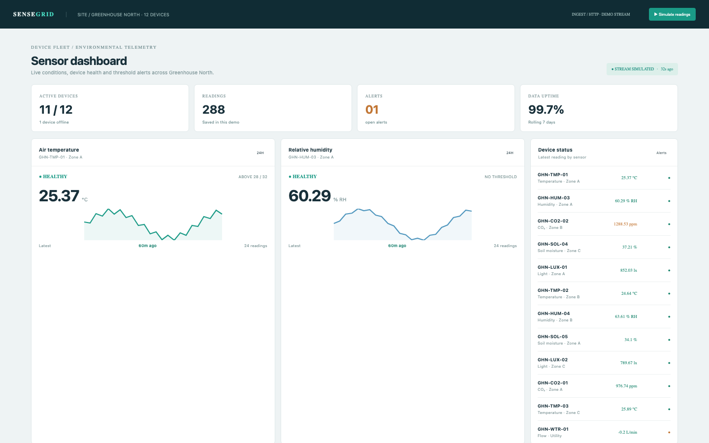

# Sensor Dashboard

An IoT operations dashboard: devices post readings to an HTTP ingest endpoint, with live values, history charts, thresholds and an alert log.

## Run it

```sh
npm install
npm start
```

Open the address it prints. `npm test` runs the tests (node:test; no network, no key).

## What to ask the chat next

- Ingest a CO₂ reading above 1500 ppm and open the alert.
- Acknowledge the open alert from the alert log.
- Lower the temperature warning threshold and simulate readings.

## Screenshot


